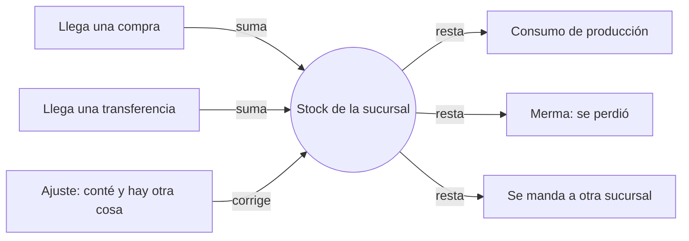
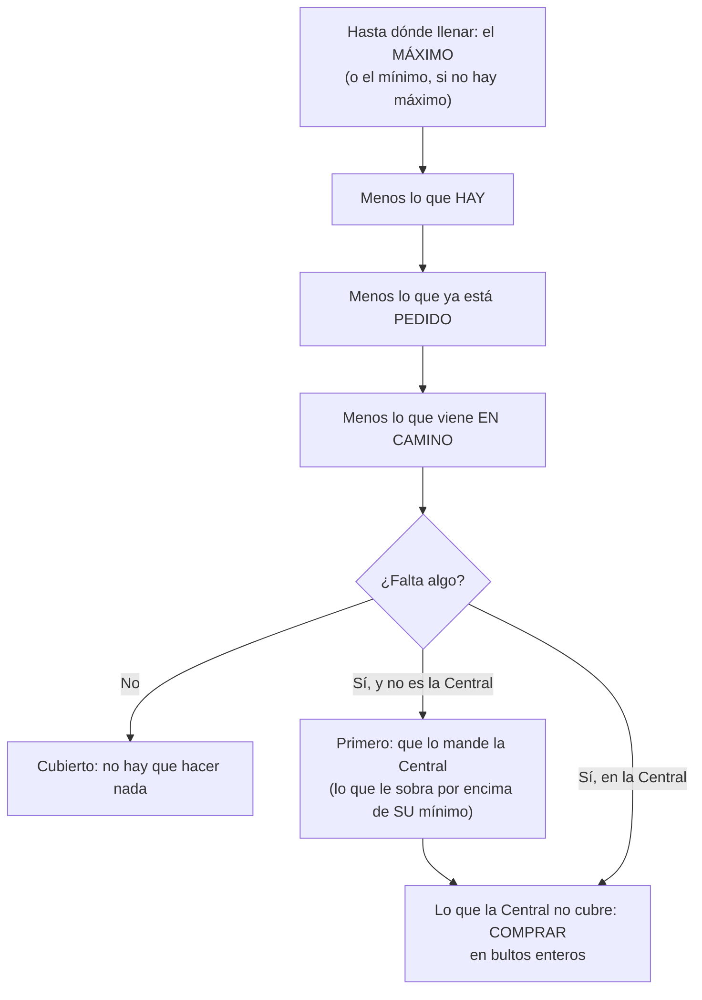
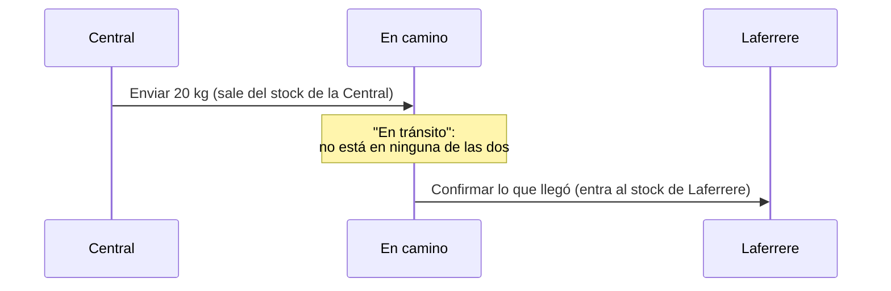
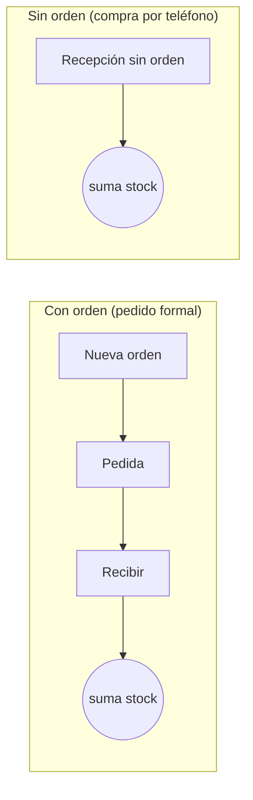

# Manual de uso del Gestor de Panadería

> [!info] Para quién es este manual
> Para las personas que **usan** el sistema todos los días: el dueño, los
> encargados y los empleados. No hace falta saber nada de computación.
> Si buscás cómo instalarlo o mantenerlo, eso está en [[operacion]] y
> [[deploy-vps]].

## Índice

1. [[#La idea en dos minutos]]
2. [[#Entrar al sistema]]
3. [[#La pantalla: qué es cada parte]]
4. [[#Quién puede hacer qué]]
5. Las pantallas, una por una:
   - [[#Inicio]] · [[#Reposición]] · [[#Stock]] · [[#Transferencias]]
   - [[#Compras]] · [[#Insumos]] · [[#Proveedores]]
6. [[#El día a día: recetas paso a paso]]
7. [[#Cuando algo sale mal]]
8. [[#Palabras que usa el sistema]]

---

## La idea en dos minutos

El sistema lleva el **stock de la materia prima** (harina, levadura, manteca,
bolsas...) de cada sucursal. No se escribe "cuánto hay": se anota **cada cosa
que pasa**, y el sistema hace la cuenta.



Es como el resumen del banco: el banco no "escribe tu saldo", anota cada
depósito y cada gasto, y el saldo es la suma. Por eso:

> [!important] Tres reglas que conviene entender desde el primer día
>
> 1. **El stock es de una sucursal.** La Central y Laferrere tienen cada una el
>    suyo. Siempre fijate en qué sucursal estás trabajando (arriba a la derecha).
> 2. **Nada se borra.** Si cargaste algo mal, se **anula**: queda escrito que se
>    cargó y que se anuló. Así nunca se pierde la historia.
> 3. **Pedir no es tener.** Una orden de compra no suma stock: suma cuando la
>    mercadería **llega** y se registra la recepción.

---

## Entrar al sistema

1. Abrí la dirección de la web en el navegador (en la tablet o en la PC).
2. Escribí tu **Email** y tu **Contraseña** → **Entrar**.

> [!tip] Tema claro u oscuro
> En la pantalla de entrada (y después, arriba a la derecha) hay un selector
> **Claro / Oscuro / Automático**. "Automático" sigue lo que tenga configurado
> la tablet o la computadora. Se recuerda para la próxima vez.

> [!warning] Si te equivocás varias veces la contraseña
> Después de varios intentos fallidos el sistema te hace esperar unos minutos
> antes de dejarte probar otra vez. Es una protección contra quien quiera
> adivinar contraseñas. Esperá y volvé a intentar, o pedile al dueño que te
> confirme la contraseña.

Para salir: botón **Salir**, arriba a la derecha. Si la tablet la usan varias
personas, **salí siempre** al terminar: lo que cargues queda a tu nombre.

---

## La pantalla: qué es cada parte

```
┌──────────────────────────────────────────────────────────────────────────┐
│ Panadería Laferrere                 [Central ▾] [Automático ▾] [Salir]   │ ← encabezado
│ Juana · Encargado                                                        │
├──────────────────────────────────────────────────────────────────────────┤
│ Inicio  Reposición (5)  Stock  Transferencias  Compras  Insumos  Prov…   │ ← menú
├──────────────────────────────────────────────────────────────────────────┤
│                                                                          │
│                         la pantalla elegida                              │
│                                                                          │
└──────────────────────────────────────────────────────────────────────────┘
```

| Parte                         | Para qué sirve                                                                                                                                |
| ----------------------------- | --------------------------------------------------------------------------------------------------------------------------------------------- |
| **Nombre y rol**              | Quién está usando el sistema ahora.                                                                                                           |
| **Selector de sucursal**      | En qué sucursal estás trabajando. **Todo lo que cargues va a esta sucursal.** Si trabajás en una sola, en vez del selector aparece su nombre. |
| **Selector de tema**          | Claro, oscuro o automático.                                                                                                                   |
| **Salir**                     | Cierra tu sesión.                                                                                                                             |
| **Menú**                      | Las pantallas. Cada persona ve solo las que puede usar (ver [[#Quién puede hacer qué]]).                                                      |
| **El número rojo o amarillo** | Cuántos insumos están **por debajo del mínimo** en la sucursal elegida. **Rojo** = hay alguno que se terminó. **Amarillo** = hay alguno bajo. |

> [!tip] En una pantalla angosta
> Si no entran todas las pestañas del menú, deslizá el menú de costado.

---

## Quién puede hacer qué

Hay tres **roles**. El dueño los asigna.

| Puede…                                          | Dueño |         Encargado         |       Empleado       |
| ----------------------------------------------- | :---: | :-----------------------: | :------------------: |
| Ver el stock y el historial                     |  ✅   |            ✅             |          ✅          |
| Cargar **consumo** y **mermas**                 |  ✅   |            ✅             |          ✅          |
| Ver y confirmar lo que llega en transferencias  |  ✅   |    ✅ (sus sucursales)    | ver sí, confirmar no |
| Cargar el **saldo inicial** y hacer **ajustes** |  ✅   |            ✅             |          ❌          |
| **Anular** un movimiento mal cargado            |  ✅   |            ✅             |          ❌          |
| Dejar el stock en negativo a propósito          |  ✅   |            ✅             |          ❌          |
| Editar **insumos** y **proveedores**            |  ✅   |            ✅             |          ❌          |
| Ver **precios**, compras y reposición           |  ✅   |            ✅             |          ❌          |
| **Recibir** mercadería (compras)                |  ✅   |    ✅ (sus sucursales)    |          ❌          |
| **Enviar** transferencias                       |  ✅   | ✅ (desde sus sucursales) |          ❌          |
| **Hacer pedidos** a proveedores y plantillas    |  ✅   |            ❌             |          ❌          |
| **Anular** una recepción de compra              |  ✅   |            ❌             |          ❌          |

> [!note] Por qué el empleado no ve precios
> El empleado ve **cantidades**, no plata: no ve compras, ni proveedores, ni el
> costo de los insumos. Es una decisión del negocio, no un error.

> [!note] Las sucursales del encargado
> El dueño trabaja en todas las sucursales. El encargado y el empleado, solo en
> las que el dueño les asignó.

---

## Inicio

Lo primero que se ve al entrar. Arriba está la tarjeta **"Hoy en
(sucursal)"**, con lo que necesita atención **hoy**:

| Aviso                                     | Qué significa                                                            | Al tocarlo…                                              |
| ----------------------------------------- | ------------------------------------------------------------------------ | -------------------------------------------------------- |
| 🔴/🟡 _"N insumos por debajo del mínimo"_ | Hay que reponer. Entre paréntesis, cuántos se terminaron del todo.       | Va a [[#Reposición]] (o a [[#Stock]] si no ves compras). |
| 🟡 _"N transferencias vienen en camino"_  | Otra sucursal mandó mercadería y hay que confirmarla cuando llegue.      | Va a [[#Transferencias]].                                |
| 🔴 _"N compras atrasadas"_                | Pasó la fecha de entrega que se había anotado y el proveedor no entregó. | Va a [[#Compras]].                                       |

Si está todo bien, dice **"Todo en orden"**. Abajo hay datos de tu sesión y
del sistema (para quien da soporte).

---

## Reposición

> [!abstract] La pantalla del dueño a la mañana
> Responde una sola pregunta: **qué hay que traer, de dónde y cuánto.**
> (La ven el dueño y el encargado.)

### Qué entra en la lista

Solo los insumos que **tienen un mínimo configurado** y están por debajo. Un
insumo sin mínimo no se controla (el mínimo se pone en [[#Insumos]], en la
ficha de cada uno).

### Cómo hace la cuenta



> [!example] Ejemplo con números
> En Laferrere hay **10 kg** de harina; el mínimo es 50 y el máximo 80.
> Faltan **70 kg** para llegar a 80.
> A la Central (mínimo 100) le quedan 120: le **sobran 20**.
> → **Que la Central mande 20 kg**, y **comprar 50 kg** → 2 bolsas de 25 kg.

Dos cosas que conviene saber:

- **Nunca se pide dos veces.** Si ya hay una orden de compra pedida o una
  transferencia en camino, la reposición la descuenta.
- **Siempre bultos enteros.** Si faltan 60 kg y el proveedor vende bolsas de
  25, sugiere **3 bolsas** (75 kg), no 2,4.

### Qué hay en la pantalla

1. **"Que lo mande Central"**: por cada sucursal, qué le puede mandar la
   Central. Botón **Armar la transferencia**: abre el envío ya completo. Solo
   revisás y tocás _Enviar_. Si estabas parado en otra sucursal, el sistema te
   pasa a la Central.
2. **"Comprar"**: un bloque por **proveedor y sucursal**. Cada bloque es una
   orden de compra, con el último precio pagado y el total. Botón **Crear
   orden con esto**: abre la orden ya completa.
   - _"Sin proveedor preferido"_: esos insumos no tienen a quién pedírselos.
     Marcá un proveedor preferido en la ficha del insumo.
   - Un precio en **naranja** ("precio del…") es de hace más de un mes: puede
     estar desactualizado.
3. **"Detalle por sucursal"** (plegado: tocalo para abrirlo): cada insumo en
   alerta con su semáforo, lo que hay, el mínimo, lo pedido, lo que viene y de
   dónde sale cada número.

---

## Stock

Lo que hay de cada insumo **en la sucursal elegida**.

### El semáforo

| Color                 | Significa                                         |
| --------------------- | ------------------------------------------------- |
| 🔴 **Sin stock**      | No queda nada (o está en negativo).               |
| 🟡 **Bajo el mínimo** | Queda, pero menos que el mínimo de esta sucursal. |
| 🟢 **En orden**       | Alcanza.                                          |

Arriba hay un resumen con cuántos hay de cada color. Podés **buscar** por
nombre o código, **filtrar por categoría** y tildar **"Solo lo que falta"**.

> [!note] Un saldo en rojo con signo menos
> Significa que alguien cargó una salida **sin que hubiera stock**, a
> propósito y con permiso (por ejemplo, porque faltaba cargar una compra).
> Hay que regularizarlo: cargando lo que falta o con un [[#Ajustar|ajuste]].

### Los botones de arriba

| Botón              | Para qué                                               | Quién             |
| ------------------ | ------------------------------------------------------ | ----------------- |
| **Cargar consumo** | Lo que se **usó** para producir.                       | Todos             |
| **Cargar merma**   | Lo que se **perdió** sin usarse: vencido, roto, plaga… | Todos             |
| **Ajustar**        | Corregir el stock a lo que **contaste**.               | Dueño y encargado |
| **Saldo inicial**  | El punto de partida: lo que hay el primer día.         | Dueño y encargado |

### Cargar consumo y cargar merma

Las dos pantallas funcionan igual:

1. Elegí el **insumo** y escribí la **cantidad**. Por defecto va en la unidad
   del insumo (kg, l, unidades). Si querés, elegí otra **unidad** (por
   ejemplo, _g_ para algo que se lleva en kg): el sistema convierte solo.
2. **+ Agregar otra línea** para cargar varios insumos de una vez (lo normal al
   terminar el turno).
3. **Motivo**: en la merma es **obligatorio** (vencido, roto, plaga…). En el
   consumo es opcional.
4. **Fecha y hora (opcional)**: si el hecho fue antes (la merma del sábado que
   cargás el lunes), ponela. Vacío = ahora. No se aceptan fechas futuras.
5. **Registrar**. Abajo aparece lo que quedó de cada insumo.

> [!tip] Se puede escribir con coma
> `2,5` y `2.5` valen lo mismo. Los miles con punto también: `1.250,5`.

> [!warning] "No hay stock"
> Si querés sacar más de lo que hay, el sistema te frena y te dice cuánto hay.
> El encargado y el dueño pueden tocar **Registrar igual (queda en negativo)**,
> por ejemplo cuando la mercadería está pero falta cargar una compra. Queda
> registrado con su nombre.

### Saldo inicial

El punto de partida de cada insumo en cada sucursal: **"hoy en el depósito hay
esto"**. Se carga **una sola vez** por insumo y sucursal. Después, el stock
cambia solo con compras, consumos, mermas, transferencias y ajustes.

### Ajustar

Para cuando **contaste** y el número no coincide con el del sistema.

> [!important] Se escribe lo que CONTASTE, no la diferencia
> Si el sistema dice 70 y en el depósito hay 62, escribís **62**. El sistema
> calcula que faltan 8. No hace falta hacer restas (ni pensar si va con más o
> con menos).

1. Por cada insumo contado: elegilo y escribí cuánto hay. Mientras escribís, la
   pantalla te muestra lo que dice el sistema y la diferencia.
2. **Motivo** (obligatorio): por qué hubo diferencia.
3. **Nota (opcional)**: el detalle ("revisé el depósito B el lunes").
4. Confirmar. El informe dice qué insumos se ajustaron y cuáles coincidían
   (esos no generan nada). Contar **cero** es válido: "se terminó".

### El historial de un insumo

Tocá un insumo en la lista de stock. Vas a ver:

- **Stock actual** de ese insumo en esta sucursal, y
- **todos sus movimientos**, del más nuevo al más viejo: qué fue (compra,
  consumo, merma, ajuste, transferencia…), cuánto, cuándo, quién lo cargó, el
  motivo, la nota, y de qué compra o transferencia vino.

**Anular un movimiento** (dueño y encargado): botón **Anular** en el
movimiento. No se borra: se agrega una "anulación" que lo compensa, y el
original queda tachado. Una anulación no se puede anular (si hace falta, se
carga de nuevo).

> [!note] Lo que no se anula desde el historial
> Las **compras** se anulan desde su recepción (ver [[#Compras]]), y lo de una
> **transferencia**, desde la transferencia. Así no queda la compra anulada
> por un lado y la orden diciendo "recibida" por el otro.

---

## Transferencias

Mandar insumos de una sucursal a otra (normalmente, de la Central a
Laferrere). Son **dos pasos, hechos por dos personas**:



### Las dos bandejas

Vistas desde la sucursal en la que estás trabajando:

- **Vienen para acá**: lo que te mandaron. Arriba, lo que está **en tránsito**
  (hay que confirmarlo cuando llegue).
- **Salieron de acá**: lo que mandaste. Arriba, lo que todavía no confirmaron.

Debajo de cada bandeja aparecen las **últimas** ya cerradas. Una etiqueta
**"llegó con diferencia"** indica que llegó menos de lo que salió.

### Enviar

**Enviar a otra sucursal** (dueño y encargado):

1. Sale **siempre** de la sucursal en la que estás. Si tenés que mandar desde
   la Central, primero elegí la Central arriba.
2. **Sucursal de destino**.
3. Insumos y cantidades. Cada insumo muestra **cuánto hay**.
4. **Enviar**. Desde ese momento ya no está en tu stock: está en camino.

Si te equivocaste y todavía no llegó: entrá a la transferencia → **Anular el
envío** (con el motivo). Todo vuelve a tu stock.

### Confirmar lo que llegó

En la sucursal que **recibe** (dueño o encargado de esa sucursal):

1. **Transferencias → Vienen para acá** → tocá la que llegó.
2. Aparece cada insumo con lo que salió, ya completado. Si llegó todo, no
   cambies nada (o tocá **Llegó todo**).
3. Si llegó **menos**, corregí la cantidad: la pantalla avisa
   _"faltan 2 kg: se registra como merma"_.
4. **Confirmar recepción**.

> [!info] Qué pasa con lo que no llegó
> Entra lo que salió y la diferencia se registra como **merma** en la sucursal
> que recibe, con el motivo _"Diferencia en transferencia"_. Así cada kilo
> queda explicado y la pérdida aparece en los informes de mermas.

> [!warning] Una transferencia confirmada ya no se anula
> Si se mandó de más, hacé una transferencia **de vuelta**. Así quedan
> registrados los dos hechos.

> [!tip] Estás en la Central y abrís una transferencia que va a Laferrere
> Ves "en camino" y el botón para anularla, no el formulario de recepción.
> Si sos el dueño y querés confirmarla, cambiá arriba a la sucursal Laferrere.

---

## Compras

Lo que se le **pide** a los proveedores y lo que **llega**. Lo ven el dueño y
el encargado. **Pedir** lo hace solo el dueño; **recibir**, también el
encargado.

Arriba hay dos pestañas: **Órdenes** y **Recepciones**, y tres botones:
**Plantillas**, **Recepción sin orden** y **Nueva orden**.

### Las dos formas de comprar



### Los estados de una orden

| Estado                   | Significa                                      | Qué se puede hacer                   |
| ------------------------ | ---------------------------------------------- | ------------------------------------ |
| **Borrador**             | Armada, todavía no se le pidió al proveedor.   | Editar, marcar como pedida, cancelar |
| **Pedida**               | Se le pidió; no llegó nada.                    | Editar, recibir, cancelar            |
| **Llegó una parte**      | Llegó algo y falta el resto.                   | Recibir el resto, dar por terminada  |
| **Recibida**             | Llegó todo.                                    | —                                    |
| **Cerrada con faltante** | Llegó una parte y el resto **no va a llegar**. | —                                    |
| **Cancelada**            | No se compró.                                  | —                                    |

Una orden **pedida** cuya fecha de entrega ya pasó aparece con la etiqueta roja
**atrasada**.

### Nueva orden

1. **Proveedor** y **Sucursal que recibe**.
2. **Entrega estimada (opcional)**: si pasa la fecha y no llegó, la orden
   aparece atrasada.
3. Los insumos. **Al elegir un insumo, se completan solos la presentación y el
   último precio** que se le pagó a ese proveedor. Los insumos con ★ son los
   que ese proveedor ya vende. Ajustá solo lo que cambió.
   - **Presentación**: cómo se compra ("Bolsa 25 kg") o suelto en kg.
   - **Cuántas**: debajo dice a cuánto equivale ("= 250 kg").
   - **Precio c/u**: el precio de **una** presentación. Debajo dice cuánto sale
     el kilo ("= $ 740,00 por kg").
4. Abajo se va calculando el **total estimado**.
5. Elegí:
   - **Crear pedido**: queda _Pedida_ (lo normal: lo cargás mientras le
     escribís al proveedor);
   - **Guardar borrador**: para terminarla después;
   - **Guardar como plantilla**: guarda el pedido para repetirlo (ver abajo).

### Plantillas (pedidos que se repiten)

Para "lo de todos los lunes al Molino". Una plantilla guarda el proveedor, la
sucursal y los insumos con sus cantidades, **sin precios** (al usarla se
sugiere el último que pagaste).

- **Compras → Plantillas → Pedir**: abre una orden nueva ya completa. La
  plantilla no se gasta: sigue ahí para la semana que viene.
- Desde ahí también se **editan**, se **desactivan** y se crean nuevas.

### Recibir mercadería de una orden

Cuando llega el camión:

1. **Compras → la orden → Recibir mercadería**.
2. Aparecen todos los insumos con **lo que falta** y el precio de la orden.
   - Llegó todo y al precio acordado: no toques nada.
   - Llegó menos: corregí **Llegaron**. Lo que no llegó, en **0**: queda
     pendiente para otra entrega.
   - Cambió el precio: corregilo. **Manda el precio que se pagó.**
3. **Número de remito** y **de factura** (opcionales, pero sirven para cruzar
   con los papeles).
4. **Registrar recepción**. El stock sube en ese momento.

> [!tip] El proveedor mandó de más
> En la orden no se puede recibir más de lo que falta. Lo que sobró, cargalo
> como una **Recepción sin orden**.

> [!question] ¿Y si lo que falta no va a llegar nunca?
> En la orden → **Dar por terminada**. Queda _Cerrada con faltante_ y se
> registra cuánto faltó. Sirve para saber qué proveedor falla.

### Recepción sin orden

Para lo que se compró por teléfono o en el momento: **Compras → Recepción sin
orden**. Proveedor, sucursal, insumos, cantidades y **precio** (obligatorio).
Remito, factura y fecha opcionales. Al guardar, suma stock.

### El detalle de una recepción

Muestra qué llegó, el precio, cuánto salió cada kilo y el total. Y el **costo
promedio actual** de cada insumo: lo que cuesta, en promedio, cada kilo que
hay en el depósito, teniendo en cuenta las compras a distintos precios.

**Anular una recepción** (solo el dueño), por ejemplo si se cargó dos veces o
con un precio mal: botón **Anular recepción**, con el motivo. Se saca del stock
lo que había entrado, se recalcula el costo promedio, el último precio del
proveedor vuelve al anterior y, si tenía orden, vuelve a quedar pendiente. Si
la mercadería ya se usó, avisa, y se puede anular igual quedando en negativo.

### Cómo funciona el precio

- Cada recepción **actualiza sola** el último precio de ese proveedor (no hace
  falta tocarlo a mano).
- En la ficha de cada insumo se ve **cuál proveedor sale más barato y cuál más
  caro**, comparando **por kilo**: una bolsa de 50 kg a $39.500 parece más cara
  que una de 25 kg a $25.000, pero el kilo sale $790 contra $1.000.

---

## Insumos

El catálogo de todo lo que se compra y se usa.

### La lista

Buscá por nombre o código, filtrá por categoría o tildá **Incluir inactivos**.
Cada fila muestra la categoría, **en qué se lleva** el stock (kg, l, u) y
cuántas presentaciones tiene. **Nuevo insumo** (dueño y encargado).

### Nuevo insumo

Nombre, código (opcional), categoría y **la unidad en la que se lleva el
stock**.

> [!warning] La unidad no se puede cambiar después
> Todos los movimientos se guardan en esa unidad. Pensala bien: la harina en
> **kg** (aunque se compre en bolsas), los huevos en **unidades**, el aceite en
> **kg** si la receta lo pesa o en **l** si lo mide.

### La ficha del insumo

| Sección                       | Para qué                                                                                                                                                                                                                                                           |
| ----------------------------- | ------------------------------------------------------------------------------------------------------------------------------------------------------------------------------------------------------------------------------------------------------------------ |
| **Datos del insumo**          | Nombre, código, categoría. **Desactivar** lo saca de las listas (no se borra: el historial queda).                                                                                                                                                                 |
| **Presentaciones de compra**  | Cómo se compra: "Bolsa 25 kg" = 25 kg. Se agregan con nombre y cuánto trae. Una se puede marcar como la que se propone por defecto. Lo que trae una presentación no se cambia: si cambió, se desactiva y se crea otra.                                             |
| **Stock mínimo por sucursal** | El **mínimo** (por debajo, aparece en alerta y en la reposición), el **máximo** (hasta dónde se repone; opcional) y la **ubicación** en el depósito ("Depósito B, estante 3"). Cada sucursal tiene los suyos.                                                      |
| **Quién me lo provee**        | Los proveedores de este insumo, con su presentación, su último precio y su fecha, cuánto sale por kilo, y las marcas **más barato** / **más caro**. Arriba, el **costo promedio**. El **preferido** es a quién se le pide en la reposición (**Marcar preferido**). |

> [!example] El aceite: se compra en litros y se pesa en la receta
> Llevalo en **kg** y creá la presentación "Balde 20 l" con **18,4 kg**
> (20 litros × 0,92). La cuenta se hace una sola vez, al crear la
> presentación; después el sistema convierte solo.

---

## Proveedores

A quién se le compra. Lo ven el dueño y el encargado (tiene precios).

- **La lista**: buscá por nombre, razón social o CUIT. Muestra el contacto, en
  cuántos días entrega y cuántos insumos le comprás.
- **Nuevo proveedor**: nombre (obligatorio), razón social, CUIT, contacto,
  teléfono, email, dirección, **días de entrega** (0 = entrega en el día) y
  notas (pedido mínimo, días que reparte...).
- **La ficha**: los datos (editables) y **Insumos que le compro**: qué le
  comprás, en qué presentación, su código de artículo (para pedirle "10 del
  4412") y el último precio. Desde ahí se agregan insumos y se marca el
  preferido.

> [!tip] No hace falta asociar todo a mano
> Cuando registrás una compra a un proveedor de un insumo que todavía no tenía
> asociado, el sistema lo asocia solo, con el precio que pagaste.

---

## El día a día: recetas paso a paso

> [!example]- Arrancar a usar el sistema (una sola vez)
>
> 1. **Insumos**: revisá que estén todos, con su unidad y sus presentaciones.
> 2. En cada insumo, **Stock mínimo por sucursal** (sin mínimo, no hay alertas).
> 3. **Proveedores**: cargá los tuyos y en cada insumo marcá el **preferido**.
> 4. **Stock → Saldo inicial**, en cada sucursal: lo que hay hoy en el depósito.

> [!example]- Al terminar el turno (empleado o encargado)
>
> 1. Fijate que arriba esté **tu sucursal**.
> 2. **Stock → Cargar consumo**: todo lo que se usó, en varias líneas.
> 3. Si algo se rompió o venció: **Cargar merma**, con su motivo.

> [!example]- A la mañana (dueño)
>
> 1. **Inicio**: mirá los avisos de "Hoy".
> 2. **Reposición**: primero **Armar la transferencia** desde la Central;
>    después, por proveedor, **Crear orden con esto**.
> 3. Revisá la orden y **Crear pedido** (mientras le escribís al proveedor).

> [!example]- Llegó el camión del proveedor (dueño o encargado)
>
> 1. **Compras** → la orden → **Recibir mercadería**.
> 2. Corregí lo que llegó distinto (cantidad o precio); lo que no llegó, en 0.
> 3. Remito y factura → **Registrar recepción**.
> 4. Si no tenía orden: **Recepción sin orden**.

> [!example]- Llegó una transferencia de la Central (encargado de Laferrere)
>
> 1. **Inicio** te avisa, o **Transferencias → Vienen para acá**.
> 2. Abrila, contá lo que bajó y corregí si falta algo.
> 3. **Confirmar recepción**.

> [!example]- Conté el depósito y no coincide (dueño o encargado)
>
> 1. **Stock → Ajustar**.
> 2. Escribí **lo que hay** de cada insumo contado (no la diferencia).
> 3. Motivo y nota → confirmar.

---

## Cuando algo sale mal

| Problema                                                | Qué hacer                                                                                              |
| ------------------------------------------------------- | ------------------------------------------------------------------------------------------------------ |
| Cargué un consumo o una merma mal                       | **Stock** → tocá el insumo → **Anular** ese movimiento → cargalo bien.                                 |
| Cargué una compra mal                                   | **Compras → Recepciones** → la recepción → **Anular recepción** (el dueño) → cargala de nuevo.         |
| Mandé una transferencia a la sucursal equivocada        | Si todavía no llegó: la transferencia → **Anular el envío**. Si ya llegó: una transferencia de vuelta. |
| El stock no coincide con lo que hay                     | **Stock → Ajustar** con lo contado.                                                                    |
| La lista de reposición está vacía pero falta mercadería | Fijate que el insumo tenga **mínimo** en esa sucursal (ficha del insumo).                              |
| No veo una pestaña o un botón                           | Tu rol no lo permite (ver [[#Quién puede hacer qué]]). Pedíselo al dueño.                              |
| No me deja cargar en otra sucursal                      | Solo podés operar en las sucursales que te asignaron.                                                  |
| "Ocurrió un error inesperado… avisá con este código"    | Anotá el código y pasáselo a quien da soporte: con eso encuentra exactamente qué pasó.                 |
| "No hay stock" y la mercadería está                     | Seguramente falta cargar una compra o una transferencia. Cargala primero.                              |

---

## Palabras que usa el sistema

| Palabra                 | Qué significa                                                                 |
| ----------------------- | ----------------------------------------------------------------------------- |
| **Insumo**              | Lo que se compra y se usa: harina, levadura, bolsas. (No lo que se vende.)    |
| **Unidad base**         | La unidad en la que se lleva el stock de un insumo (kg, l, u).                |
| **Presentación**        | Cómo se compra: "Bolsa 25 kg".                                                |
| **Sucursal**            | Un local. El stock es de cada sucursal.                                       |
| **Central**             | La sucursal que produce y abastece a las demás.                               |
| **Movimiento**          | Cada cosa que cambia el stock: compra, consumo, merma, ajuste, transferencia. |
| **Consumo**             | Lo que se usó para producir.                                                  |
| **Merma**               | Lo que se perdió sin usarse. Siempre con motivo.                              |
| **Ajuste**              | Corrección del stock a lo contado.                                            |
| **Anular**              | Compensar un movimiento mal cargado. No se borra nada.                        |
| **Saldo inicial**       | El stock del primer día.                                                      |
| **Stock mínimo**        | Por debajo de esto, el insumo aparece en alerta.                              |
| **Stock máximo**        | Hasta dónde se repone.                                                        |
| **Orden de compra**     | Lo que se le pide al proveedor. **No suma stock.**                            |
| **Recepción**           | Lo que llegó. **Suma stock.**                                                 |
| **Remito**              | El papel que trae el repartidor.                                              |
| **Plantilla**           | Un pedido que se repite, guardado con nombre.                                 |
| **Transferencia**       | Envío de una sucursal a otra, en dos pasos.                                   |
| **En tránsito**         | Ya salió de una sucursal y todavía no llegó a la otra.                        |
| **Proveedor preferido** | A quién se le pide un insumo en la reposición.                                |
| **Costo promedio**      | Lo que cuesta, en promedio, cada kilo que hay en el depósito.                 |
| **Reposición**          | La lista de qué traer, de dónde y cuánto.                                     |
