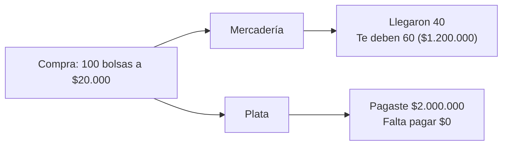

# Manual de uso del Gestor de Panadería

> [!info] Para quién es este manual
> Para quien **usa** el sistema: el dueño. Está pensado para el celular y para
> la computadora. No hace falta saber nada de computación.
> Cómo se instala y se mantiene está en [[operacion]] y [[deploy-vps]]. Las
> pantallas de stock (ocultas por ahora) tienen su propio manual:
> [[manual-etapa-stock]].

## Índice

1. [[#La idea en dos minutos]]
2. [[#Entrar y moverse por la web]]
3. [[#Lo que me deben (la pantalla principal)]]
4. [[#Compras]]: [[#Nueva compra]] · [[#El detalle de una compra]] ·
   [[#Registrar un pago]] · [[#Registrar una entrega]] ·
   [[#Cuando lo que falta no va a llegar]] · [[#El historial y las notas]]
5. [[#Proveedores e insumos]]
6. [[#Reportes]]
7. [[#Mi cuenta]]
8. [[#El día a día: recetas paso a paso]]
9. [[#Cuando algo sale mal]]
10. [[#Palabras que usa el sistema]]

---

## La idea en dos minutos

Comprás **mucho de una vez** (100 bolsas de harina), lo **pagás por
adelantado**, y el proveedor te lo **entrega de a poco** (20 esta semana, 20 la
que viene). Eso se llama **compra en acopio**. El sistema lleva la cuenta de
**cuánto te deben** de cada compra, para que no tengas que acordarte ni
anotarlo en un cuaderno.

Cada compra tiene **dos cuentas**, que se mueven por separado:

> [!important] Tres cosas que conviene saber desde el primer día
>
> 1. **Cada compra mantiene su precio.** Si compraste a $20.000 la bolsa, lo que
>    te deben vale $20.000 la bolsa, aunque hoy esté más cara. Así el número de
>    "te deben" es exacto.
> 2. **Nada se borra.** Si cargaste algo mal, se **anula** con un motivo: queda
>    escrito que se cargó y que se anuló. La historia de cada compra está
>    completa.
> 3. **Pedir no es tener.** La compra dice lo que compraste. Lo que llega se
>    anota como **entrega**, cada vez que viene el camión.

---

## Entrar y moverse por la web

Entrás con tu **email y tu contraseña**. Si te equivocás muchas veces seguidas,
el sistema te hace esperar unos minutos: es para que nadie pueda probar
contraseñas.

**El menú** tiene cinco lugares:

| Pestaña         | Para qué                                                   |
| --------------- | ---------------------------------------------------------- |
| **Me deben**    | Lo que te deben, de quién y de qué compra. Es el inicio.   |
| **Compras**     | Todas las compras y todas las entregas.                    |
| **Proveedores** | A quién le comprás, con sus datos y sus precios.           |
| **Insumos**     | Lo que comprás: harina, azúcar, levadura… y cómo viene.    |
| **Reportes**    | Todos los números: gastos, precios, proveedores, entregas. |

> [!tip] En el celular el menú está ABAJO
> En la computadora está arriba, como pestañas. En el celular es una barra fija
> abajo, donde llega el pulgar.

**Arriba** está el nombre de la panadería y el tuyo: **tocando tu nombre** vas a
[[#Mi cuenta]]. A la derecha, **Salir**.

---

## Lo que me deben (la pantalla principal)

Responde una sola pregunta: **¿qué me deben, a quién y de qué compra?**

- **Te deben en mercadería**: lo que falta que te entreguen, sumando todas las
  compras, al precio de cada una.
- **Plata tuya en los proveedores**: lo que **pagaste y todavía no te
  entregaron**. Si pagaste $2.000.000 por 100 bolsas y llegaron 40, el
  proveedor tiene $1.200.000 tuyos.
- **Quién te debe**: una tarjeta por proveedor, el que más debe primero. Cada
  renglón dice el insumo, de qué compra es, cuánto falta ("faltan 60 × Bolsa 25
  kg") y cuánto vale. **Tocándolo** vas a esa compra.
- **Te tienen que devolver**: aparece solo si pagaste una compra y después la
  diste por terminada o la cancelaste sin que llegara todo. Es plata que el
  proveedor te debe.
- **Compras abiertas, de la más vieja a la más nueva**: hace cuánto pediste cada
  una y cuánto llegó, con una barra. Si pasó más de un mes, los días se ven en
  rojo.

> [!example] Ejemplo con números
> Compraste 100 bolsas de Harina 000 a $20.000 (total $2.000.000) y la pagaste
> por Mercado Pago. Llegaron 20 el lunes y 20 el lunes siguiente.
> La pantalla dice: **te deben 60 × Bolsa 25 kg ($1.200.000)**, y en "plata
> tuya en los proveedores" **$1.200.000**.

El botón **Nueva compra** está acá mismo.

---

## Compras

La pestaña **Compras** tiene dos listas: **Compras** (todo lo que pediste) y
**Entregas** (todo lo que llegó). Cada compra muestra su estado y si está
pagada.

**Los estados de una compra:**

| Estado                   | Qué significa                                                     |
| ------------------------ | ----------------------------------------------------------------- |
| **Borrador**             | La estás armando; todavía no se la pediste al proveedor.          |
| **Pedida**               | Se la pediste; no llegó nada.                                     |
| **Llegó una parte**      | Llegaron algunas tandas; falta el resto.                          |
| **Recibida**             | Llegó todo.                                                       |
| **Cerrada con faltante** | Llegó una parte y el resto **no va a llegar** (lo decidiste vos). |
| **Cancelada**            | No llegó nada y ya no se compra.                                  |

**Y el estado de pago:** **Sin pagar**, **Pagada en parte** o **Pagada**. Nadie
lo elige: sale de comparar lo pagado con el total.

### Nueva compra

1. **Proveedor** y **Sucursal que recibe** (la de siempre; cada entrega puede ir
   a otra, ver [[#Registrar una entrega]]).
2. **Qué**: el insumo, cómo viene (**Presentación**: "Bolsa 25 kg"), **Cuántas**
   y el **Precio c/u** (por bolsa). Al elegir el insumo, si ya le compraste a
   ese proveedor, el precio aparece solo. **+ Agregar otro insumo** para comprar
   varios en la misma compra.
3. Abajo, uno de estos botones:
   - **Crear pedido**: la compra queda **pedida**. Es lo normal.
   - **Guardar borrador**: para terminarla después.
   - **Guardar como plantilla**: si es un pedido que se repite ("pedido semanal
     del molino"); la próxima vez se arma solo.

> [!tip] El precio se puede escribir como siempre
> "20.000" son veinte mil, y "20.000,50" también vale. El total aparece abajo
> mientras escribís.

> [!warning] Sin precio no se puede pagar
> Podés crear una compra sin precio, pero para registrar un pago hace falta el
> precio de todos los insumos (sin eso no hay total). Se corrige con **Editar**.

### El detalle de una compra

Arriba: el número de compra, el proveedor, el estado y el estado de pago. Los
botones que aparecen dependen del estado:

- **Registrar entrega**: llegó el camión.
- **Marcar como pedida**: para un borrador.
- **Editar**: mientras no haya llegado nada. Si ya la pagaste, el total no puede
  quedar por debajo de lo pagado.
- **Dar por terminada**: lo que falta no va a llegar.
- **Cancelar**: no llegó nada y no se compra.

Después, cuatro tarjetas:

1. **Comprado, entregado y lo que falta**: por insumo, cuánto pediste, cuánto
   llegó y cuánto falta.
2. **Pagos**: total, pagado, falta pagar y estado; la lista de pagos con sus
   fotos; y el botón **Registrar pago**.
3. **Entregas de esta compra**: cada tanda que llegó.
4. **Historial**: todo lo que pasó, en orden (ver [[#El historial y las notas]]).

### Registrar un pago

En el detalle de la compra, **Registrar pago**:

1. **Monto**: viene escrito con lo que falta pagar. Si pagás todo, no lo toques.
2. **Cómo pagaste**: **Efectivo**, **Transferencia** o **Mercado Pago** (un
   toque).
3. **Comprobante**: **Sacar foto o elegir captura**. En el celular podés sacar
   la foto en el momento o elegir la captura de la transferencia de la galería.
   Hasta 4 imágenes. Antes de guardar se ven en miniatura, y la **×** saca una.
4. **Cuándo pagaste** (si lo cargás otro día) y una **Nota** (opcional).
5. **Guardar pago**.

> [!tip] La foto se achica sola
> No importa que la foto del celular pese mucho: el sistema la achica antes de
> subirla, y se sigue leyendo perfecto.

**Ver un comprobante:** tocá la miniatura y se abre grande. **Cerrar** (o la
tecla Escape) para volver; **Abrir** la muestra en otra pestaña.

**¿Te olvidaste la foto?** En el pago, **Agregar foto**.

**¿Te equivocaste?** En el pago, **Anular**, y escribí por qué ("cargué un cero
de más"). El pago queda tachado, con el motivo, y deja de contar. También se usa
cuando **el proveedor te devolvió la plata**.

> [!warning] No se puede pagar de más
> Si el monto es más de lo que falta pagar, el sistema no lo deja y te dice
> cuánto falta. Casi siempre es un cero de más.

### Registrar una entrega

Llegó el camión: en el detalle de la compra, **Registrar entrega**.

1. **Adónde llegó**: elegí la **Sucursal** (Catán o Laferrere). Por defecto, la
   de la compra.
2. **Qué llegó**: cada insumo trae escrito cuánto falta. Escribí en **Llegaron**
   lo que vino. Lo que no vino, dejalo en cero.
   - **Llegó todo** completa todo lo que falta.
   - **Poner todo en cero** vacía todo, para escribir solo lo que llegó.
3. **Papeles** (opcionales): el número de **remito**, de **factura**, **cuándo
   llegó** (si lo cargás después), una nota y la **Foto del remito**.
4. **Registrar entrega**.

> [!note] El precio no se vuelve a pedir
> La compra ya tiene su precio, y es el que vale. La pantalla lo muestra al lado
> de cada insumo ("a $20.000 c/u").

> [!tip] El proveedor mandó de más
> No se puede registrar más de lo que falta. Si vino de más, lo que sobra se
> carga aparte con **Llegó sin compra cargada** (en la pestaña Compras).

**Llegó sin compra cargada** sirve también para lo que comprás y te llevás en
el momento (en un mayorista): anota la compra y la entrega de una vez.

### Cuando lo que falta no va a llegar

En el detalle de la compra, **Dar por terminada** (si llegó una parte) o
**Cancelar** (si no llegó nada), con una nota de por qué.

> [!important] Si la habías pagado, te deben plata
> El sistema calcula lo que pagaste y no llegó, y lo muestra en **Lo que me
> deben → Te tienen que devolver** y en la tarjeta de Pagos de la compra. Cuando
> el proveedor te devuelva la plata, **anulá el pago** con el motivo "devolvió la
> plata" y deja de figurar.

### El historial y las notas

La tarjeta **Historial** muestra todo lo que le pasó a la compra, en orden y con
quién lo hizo: creada, pagos, entregas, pagos o entregas anuladas, notas,
cierre. Tocando una entrega vas a su detalle.

Arriba del historial podés **anotar algo** que no es un pago ni una entrega
("dicen que la próxima viene el 19") y **Agregar nota**. Las notas no se borran:
son parte de la historia.

---

## Proveedores e insumos

**Insumos** es la lista de lo que comprás. Cada insumo tiene:

- una **unidad** en la que se cuenta (kg, litros, unidades). **No se puede
  cambiar después**, así que elegila bien: la harina, en kg;
- sus **presentaciones**: cómo lo compra ("Bolsa 25 kg", "Bolsa 50 kg",
  "Maple 30 u"). Es lo que se elige al comprar.

**Proveedores** es la lista de a quién le comprás, con sus datos (CUIT,
teléfono, contacto, días de entrega) y **qué insumos te vende y a qué precio**.

> [!tip] Los precios se aprenden solos
> No hace falta cargar los precios a mano: cada compra actualiza el último
> precio de ese proveedor, y la próxima compra lo sugiere.

---

## Reportes

En **Reportes** elegís **Qué reporte** en la lista. Los tres primeros son una
foto de **hoy**; el resto, de un **período** (**Desde** / **Hasta**, o los
atajos **Este mes**, **3 meses**, **12 meses**).

| Reporte                               | Qué contesta                                                                |
| ------------------------------------- | --------------------------------------------------------------------------- |
| **Mercadería que me deben**           | ¿Qué me deben y cuánto vale? (como el inicio, en tabla)                     |
| **Plata adelantada y a favor**        | ¿Cuánta plata mía tiene cada proveedor?                                     |
| **Compras abiertas por antigüedad**   | ¿Hace cuánto pagué y todavía no terminó de llegar?                          |
| **Gasto por mes**                     | ¿Cuánto compré y cuánto pagué cada mes? ¿Más o menos que el mes anterior?   |
| **Gasto por proveedor**               | ¿Con quién se me va la plata?                                               |
| **Gasto por insumo**                  | ¿En qué se me va la plata, y cuántos kg compré?                             |
| **Pagos por medio**                   | ¿Cuánto pagué en efectivo, por transferencia y por Mercado Pago?            |
| **Evolución del precio de un insumo** | ¿Cuánto pagué el kg de harina en cada compra? (con un gráfico de línea)     |
| **Comparar proveedores por insumo**   | ¿Quién me lo vendió más barato? (promedio, mínimo, máximo, último)          |
| **Cumplimiento de los proveedores**   | ¿Cuánto tarda cada uno en entregar todo? ¿Cuánto me entregó de lo comprado? |
| **Entregas por semana**               | ¿Qué llegó cada semana, de quién y a qué sucursal?                          |

> [!note] Comprado y pagado no son lo mismo
> **Comprado** es lo que valen las compras, por el día en que las pediste.
> **Pagado** es la plata que salió, por el día de cada pago. Como pagás por
> adelantado, casi siempre coinciden; si no, la diferencia es lo que falta pagar.
> Las compras canceladas y los borradores no cuentan como gasto.

> [!tip] Precio por kg
> La evolución y la comparación de precios están **por kg** (o por la unidad del
> insumo): es la única forma de comparar una bolsa de 25 kg con una de 50, o al
> molino con el mayorista.

Cada reporte tiene dos botones:

- **Descargar CSV**: baja una planilla que se abre con **Excel** o Google
  Sheets, con los números listos para hacer cuentas.
- **Imprimir**: imprime (o guarda en PDF) solo el reporte, sin el menú ni los
  botones.

---

## Mi cuenta

Tocando **tu nombre** arriba:

- **Cambiar la contraseña**: escribís la actual, la nueva (8 caracteres o más) y
  la repetís. Si tenías la sesión abierta en otro lado (otro celular, otra
  computadora), **se cierra**.
- **Cambiar el email con el que entrás**: el nuevo y tu contraseña.
- **Apariencia**: claro, oscuro o automático (según el teléfono).

> [!important] La contraseña inicial
> La primera contraseña la generó el sistema. **Cambiala por una tuya** la
> primera vez que entres, y poné tu email de verdad.

---

## El día a día: recetas paso a paso

> [!example]- El primer día (una sola vez)
>
> 1. **Mi cuenta**: tu contraseña y tu email.
> 2. **Insumos → Nuevo insumo**: cargá lo que comprás (Harina 000 en kg, Azúcar
>    en kg, Huevos en unidades…) y a cada uno sus **presentaciones** (Bolsa 25
>    kg, Bolsa 50 kg, Maple 30 u).
> 3. **Proveedores → Nuevo proveedor**: el molino, el distribuidor, el
>    mayorista. Los precios se van a cargar solos con las compras.

> [!example]- Compré 100 bolsas al molino y las pagué
>
> 1. **Nueva compra** → el molino, Harina 000, Bolsa 25 kg, **Cuántas** 100,
>    **Precio c/u** 20.000 → **Crear pedido**.
> 2. En la compra: **Registrar pago** → el monto ya está → **Mercado Pago** →
>    **Sacar foto o elegir captura** (la captura de la transferencia) →
>    **Guardar pago**.
> 3. Queda **Pagada**, y en **Me deben** aparecen las 100 bolsas.

> [!example]- Llegó el camión con 20 bolsas
>
> 1. **Me deben** → tocá la harina de esa compra.
> 2. **Registrar entrega** → elegí la sucursal → **Llegaron** 20 → la foto del
>    remito → **Registrar entrega**.
> 3. En **Me deben** ahora dice "faltan 80".

> [!example]- El molino avisó que no le queda más
>
> 1. En la compra, **Dar por terminada**, con la nota ("el molino no tiene
>    más").
> 2. Si la habías pagado, en **Me deben → Te tienen que devolver** queda lo que
>    te deben en plata.
> 3. Cuando te devuelvan, **Anular** el pago con el motivo "devolvió la plata".

> [!example]- A fin de mes
>
> **Reportes → Gasto por mes** (cuánto gastaste), **Evolución del precio** (cómo
> subió la harina) y **Cumplimiento** (qué proveedor tarda más). **Descargar
> CSV** si querés guardarlo en una planilla.

---

## Cuando algo sale mal

| Pasa esto                                            | Qué hacer                                                                                           |
| ---------------------------------------------------- | --------------------------------------------------------------------------------------------------- |
| "Ese monto es más de lo que falta pagar"             | Revisá el monto: casi siempre es un cero de más.                                                    |
| "Hay insumos de esta compra sin precio"              | **Editar** la compra y cargar el precio que falta.                                                  |
| "De Harina faltan 6 y querés recibir 7"              | Llegó de más: lo que sobra va con **Llegó sin compra cargada**.                                     |
| "Eso no es una imagen"                               | El comprobante tiene que ser una foto o una captura (no un PDF). Sacale una captura y subí esa.     |
| "La compra 3 está recibida: no se puede…"            | La acción no corresponde al estado de la compra. Los botones que se ven son los que se pueden usar. |
| Cargué un pago o una entrega mal                     | **Anular** (con el motivo) y cargarlo de nuevo.                                                     |
| "Ocurrió un error inesperado… avisá con este código" | Anotá el código y pasáselo a quien mantiene el sistema: con eso encuentra qué pasó.                 |
| Me equivoqué muchas veces la contraseña              | Esperá unos minutos y probá de nuevo.                                                               |

---

## Palabras que usa el sistema

| Palabra               | Qué quiere decir                                                                |
| --------------------- | ------------------------------------------------------------------------------- |
| **Acopio**            | Comprar mucho, pagarlo por adelantado y retirarlo de a poco.                    |
| **Compra**            | Lo que le pediste a un proveedor, con sus insumos, cantidades y precios.        |
| **Entrega**           | Cada vez que llega mercadería de una compra (una "tanda").                      |
| **Lo que me deben**   | Lo que falta entregar de tus compras, en bolsas y en plata.                     |
| **Plata adelantada**  | Lo que pagaste y todavía no te entregaron.                                      |
| **Plata a favor**     | Lo que pagaste de una compra terminada o cancelada que no va a llegar.          |
| **Comprobante**       | La foto o captura de un pago, o la foto de un remito.                           |
| **Remito**            | El papel que trae el repartidor con lo que entregó.                             |
| **Presentación**      | Cómo se compra un insumo: "Bolsa 25 kg", "Maple 30 u".                          |
| **Anular**            | Dejar sin efecto algo cargado mal. No se borra: queda escrito, con el motivo.   |
| **Dar por terminada** | Cerrar una compra cuando lo que falta no va a llegar ("cerrada con faltante").  |
| **Precio por kg**     | El precio de la bolsa dividido por lo que trae: para comparar bolsas distintas. |
| **CSV**               | Una planilla simple que se abre con Excel.                                      |
